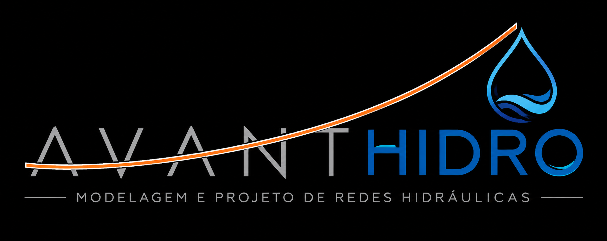
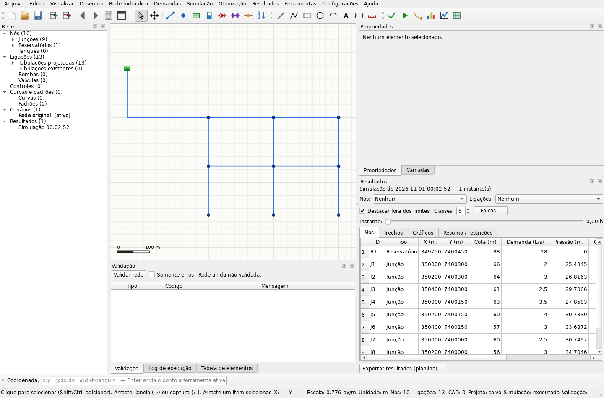

<p align="center">
  
</p>

<h1 align="center">AVANT HIDRO 1.2.0</h1>

<p align="center"><b>Simulador hidráulico baseado em Python</b><br>
Desenho, simulação e otimização de redes de distribuição de água num único programa.<br>
Modelagem e projeto de redes hidráulicas. Código aberto sob MIT.</p>

## Apoie o projeto original

O AVANT HIDRO deriva do HidroPy, de Caio Henrique de Oliveira Nascimento. O QR Pix
abaixo pertence ao projeto original e é mantido aqui como forma de apoio e crédito à origem.

<p align="center">
  
</p>



## Sobre

A importação de redes QGIS/QEPANET preserva materiais, cotas dos vértices e dados
de origem, com consulta no painel de propriedades e exportação CSV do perfil.
Consulte o [guia de importação QEPANET](docs/IMPORTACAO_QEPANET.md).

AVANT HIDRO 1.2.0 é baseado no HidroPy, com nova identidade e funcionalidades.
Veja [identidade e licenças](docs/IDENTIDADE_E_LICENCAS.md).

O AVANT HIDRO é um programa desktop para projetar redes de abastecimento de água. Ele reúne um
ambiente de desenho no estilo CAD, a simulação hidráulica com o motor **EPANET** e a
**otimização econômica dos diâmetros** por algoritmo genético. A rede pode ser desenhada sobre
uma base topográfica em DXF, com coordenadas reais, e os resultados saem em mapas, planilhas,
relatórios e plantas DXF prontas para o projeto executivo.

## Funcionalidades

**Desenho e edição**
- Ambiente CAD com zoom, pan, snap (nós, extremidades, pontos médios, centros, interseções e
  grade), entrada de coordenadas absolutas, relativas e polares, camadas e desfazer/refazer.
- Linha, polilinha, retângulo, círculo, arco, texto, cota e medição; mover, rotacionar,
  espelhar, copiar e colar.
- Importação de DXF com escolha das camadas e camadas de referência bloqueadas.

**Rede hidráulica**
- Junções, reservatórios, tanques, tubulações com vértices, bombas e válvulas
  (PRV, PSV, PBV, FCV, TCV e GPV); curvas, padrões temporais e controles.
- Conversão de linhas do DXF em tubulações, divisão de tubulações e união de nós arrastando
  um sobre o outro.
- **Renumerar nós e trechos**, ao lado de Dividir tubulação em Rede hidráulica e na barra
  Rede: prefixos, dígitos, número inicial, ordenação geométrica/original/hidráulica,
  prévia de correspondência, exportação CSV e desfazer/refazer. O modo hidráulico usa
  as vazões do instante selecionado de uma simulação da rede atual.
- Trechos existentes (executados), que a otimização preserva.
- **Trocar elemento** no botão direito: junção ↔ reservatório ↔ tanque e tubulação ↔ bomba ↔
  válvula, inclusive em lote e entre subtipos de válvula. Preserva identidade, posição e
  conexões, solicita os dados do novo tipo e mostra os dados exclusivos removidos.
  Controles incompatíveis exigem remoção explícita; Ctrl+Z restaura toda a operação.
- Importação e exportação de arquivos EPANET (`.inp`).
- Validação da rede antes dos cálculos, com erros e advertências.
- **Editores de curvas e padrões no modelo do EPANET:** tabelas, descrição,
  gráfico atualizado durante a edição, equação das curvas de bomba, média e ciclo
  dos padrões, copiar/colar e arquivos PAT/CRV/CSV. Aplicar/OK grava a edição com
  desfazer/refazer; Cancelar descarta alterações pendentes. Veja
  [o guia dos editores](docs/EDITORES_EPANET.md).

**Demandas**
- Projeção populacional pelos métodos aritmético e geométrico, com tabela e gráfico.
- Consumos nodais pelo método linear (vazão por metro de rede), com coeficientes K1 e K2 e
  resumo antes de aplicar.

**Simulação e otimização**
- Simulação EPANET em regime permanente ou período estendido, executada em segundo plano.
- Modelos de demanda fixa (DDA) e dependente de pressão (PDA), com preservação das opções
  hidráulicas e dos deslocamentos temporais na importação de INP.
- Mapas temáticos de pressão, carga, demanda, vazão, velocidade, perda de carga e estado;
  setas de escoamento, destaque de valores fora dos limites e gráficos ao longo do tempo.
- **Resultados → Gráficos** (`Ctrl+G`), também no botão ao lado de Resultados: séries
  temporais com vários nós/trechos, perfil da rede, contorno, frequência acumulada e
  vazão do sistema. Permite selecionar e ordenar elementos, navegar na figura e
  exportar PNG/SVG/PDF ou os dados em CSV.
- Otimização de diâmetros por algoritmo genético, com catálogo de diâmetros e custos,
  limites de pressão e velocidade e comparação trecho a trecho com a rede original.
- Cenários para comparar alternativas sem perder a rede original.

**Saídas**
- Planilhas Excel/CSV com os resultados de nós e trechos.
- Relatórios em PDF ou HTML.
- **Planta de cálculo** em DXF, com as informações escolhidas para trechos e nós.
- **Planta de execução** em DXF, com as peças de conexão de cada junção e vértice (tês,
  cruzetas, curvas, reduções e CAPs, bolsa/ponta), chamadas em multileader e quadro de
  quantidades.
- Linha de comando com saída JSON, para automação e para agentes de IA.


## Instalação

### Executável para Windows

Baixe a versão mais recente na página de *Releases* do repositório, descompacte a pasta
`AvantHidro` e execute `AvantHidro.exe`. Não é preciso instalar Python nem outras dependências.

### A partir do código-fonte

Requer Python 3.10 ou mais recente (desenvolvido com Python 3.14).

```bash
python -m pip install -r requirements.txt
```

```bash
python main.py
```

Também é possível abrir um arquivo diretamente: `python main.py examples/rede_exemplo.shcad`
(aceita `.shcad`, `.dxf` e `.inp`).

## Primeiros passos

1. Abra `examples/rede_exemplo.shcad` ou importe uma rede `.inp` (menu **Arquivo**).
2. Valide a rede (**F4**) e execute a simulação (**F5**).
3. Explore os mapas e as tabelas no painel **Resultados**.
4. Execute a otimização de diâmetros (**F6**) e compare as soluções.
5. Exporte a planilha de resultados (**Ctrl+E**), o relatório e as plantas DXF.

O manual completo está no próprio programa, em **Ajuda → Manual do AVANT HIDRO** (**F1**).

## Linha de comando

As operações principais também rodam sem abrir a janela:

```bash
AvantHidro.exe cli simular projeto.shcad --json
```

Comandos disponíveis: `info`, `validar`, `simular`, `otimizar`, `comparar`,
`aplicar-otimizacao`, `ativar-cenario`, `exportar-dxf`, `planilha`, `relatorio` e
`importar`. A referência completa, com o formato da saída JSON, está em
[docs/CLI.md](docs/CLI.md).

## Uso com agentes de IA

O AVANT HIDRO pode ser operado por agentes de IA, como o Claude Code, por meio da linha de
comando. A pasta [`skill/avant-hidro`](skill/avant-hidro/SKILL.md) traz uma *skill* que ensina o agente
a validar, simular, otimizar e comparar cenários: basta pedir, por exemplo, *"simule a rede e
otimize os diâmetros para o melhor cenário"*. O agente roda as otimizações, grava as
alternativas como cenários no projeto e apresenta um resumo para você decidir.

Para instalar no Claude Code, copie a pasta `skill/avant-hidro` para `~/.claude/skills/`
(no Windows, `%USERPROFILE%\.claude\skills\`).

## Gerar o executável

```bash
python -m pip install pyinstaller
```

```bash
python -m pip install -r requirements-build.txt
python tools/collect_licenses.py
python tools/build_windows.py
```

O resultado fica em `dist/AvantHidro/`. Para distribuir, compacte essa pasta inteira.

## Estrutura do projeto

```
main.py            ponto de entrada (interface, linha de comando e processos de cálculo)
main4.py           otimizador de diâmetros (algoritmo genético)
AvantHidro.spec       configuração do executável (PyInstaller)
src/
  hydraulics/      modelo da rede, projeto, validação, demandas e projeção populacional
  integration/     simulação e otimização em segundo plano, importação/exportação .inp
  cad/             área de desenho, ferramentas, snap, DXF e peças de conexão
  results/         mapas temáticos, tabelas e relatórios
  ui/              janela principal, painéis e diálogos
  cli.py           linha de comando
  resources/       ícone, splash e manual
tests/             testes automatizados (pytest)
examples/          redes e desenho de exemplo
docs/              documentação complementar
skill/avant-hidro/     skill para agentes de IA (Claude Code)
```

## Testes

```bash
python -m pytest -q
```

No Windows com Python 3.12, o ambiente validado pode ser reproduzido com:

```bash
python -m pip install -r requirements-windows-py312.lock
python -m pip check
python -m pytest -q
```

O arquivo de versões fixas registra o ambiente completo usado nos testes. A integração
contínua em `.github/workflows/tests.yml` executa a suíte nesse ambiente no Windows.

Os limites de pressão da otimização são obrigatórios: o alvo é o maior valor entre a
pressão mínima e o piso absoluto, com a tolerância numérica configurada. Não há redução
automática por topografia. Soluções viáveis têm prioridade sobre as inviáveis; na falta
de solução viável, o programa apresenta a menor violação encontrada como diagnóstico.
Tubos existentes mantêm o diâmetro e ficam fora do custo de implantação, mas participam
das verificações de velocidade e perda de carga. Simulações incompletas ou sem
convergência são classificadas como falha. Veja os detalhes em
[docs/CORRECOES_CONFIABILIDADE.md](docs/CORRECOES_CONFIABILIDADE.md).

## Tecnologias

[PySide6](https://doc.qt.io/qtforpython/) (interface), [EPANET](https://www.epa.gov/water-research/epanet)
por meio do [WNTR](https://github.com/USEPA/WNTR) (simulação hidráulica),
[DEAP](https://github.com/DEAP/deap) (algoritmo genético), [ezdxf](https://ezdxf.mozman.at/)
(DXF), pandas, matplotlib e openpyxl.

## Licença

O código da aplicação é distribuído sob MIT, com o copyright original preservado em
[LICENSE](LICENSE). Veja [NOTICE.md](NOTICE.md) para origem e alterações e
[THIRD_PARTY_NOTICES.md](THIRD_PARTY_NOTICES.md) para as licenças das dependências.
A MIT da aplicação não substitui as licenças das bibliotecas.

## Origem e autoria

**Autor original do HidroPy: Caio Henrique de Oliveira Nascimento**<br>
Estudante de Engenharia Ambiental e Sanitária — IFCE, campus Maracanaú<br>
[LinkedIn](https://www.linkedin.com/in/caio-henrique-6a6650236)
